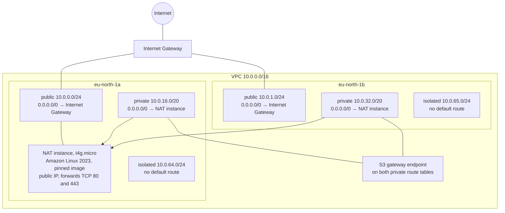
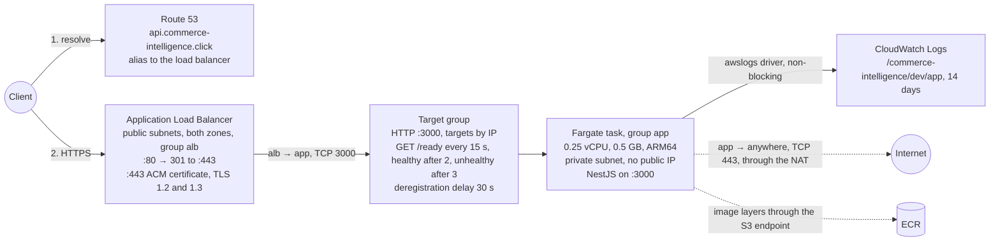
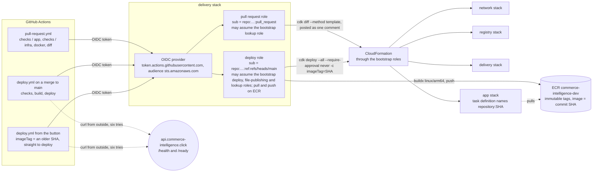

# Architecture

The Commerce Intelligence environment as deployed: stage `dev`, region `eu-north-1`, four
CloudFormation stacks defined with AWS CDK in `infra/`. This file describes what runs; the design
doc of each task records why it is shaped that way. It is updated as the environment grows.

**Last updated:** 2026-10-24, Task 1.5. Task 2.1 adds the database.

## 1. The network

Stack `commerce-intelligence-dev-network`. One VPC over two availability zones, three tiers of
subnets, one NAT instance, a free S3 gateway endpoint. Address space for a third zone is reserved
(`10.0.2.0/24`, `10.0.48.0/20`, `10.0.66.0/24`) so adding it later renumbers nothing.

Every subnet has its own route table. Public subnets do not assign public IPs on launch; the load
balancer and the NAT instance ask for theirs. Rejected traffic is logged to
`/commerce-intelligence/dev/vpc-flow-logs` for 14 days.

Security groups are the whole list of allowed traffic between tiers. None allows all outbound.

| Group  | Inbound                        | Outbound                                |
| ------ | ------------------------------ | --------------------------------------- |
| `alb`  | TCP 80 and 443 from anywhere   | TCP 3000 to `app`                       |
| `app`  | TCP 3000 from `alb`            | TCP 443 to anywhere; TCP 3306 to `data` |
| `data` | TCP 3306 from `app`            | none                                    |
| NAT    | all traffic from `10.0.0.0/16` | TCP 80 and 443 to anywhere              |

## 2. The request path

Stack `commerce-intelligence-dev-app`. One public hostname, TLS ended at the load balancer, one
Fargate task in a private subnet, logs to CloudWatch.

The service keeps one task, rolls out at 100 % minimum and 200 % maximum, and rolls back by itself
when a new task definition never passes the health check. The app keeps idle connections for 65 s
because the load balancer keeps them for 60 s.

## 3. The delivery path

Two GitHub Actions workflows and two IAM roles. A pull request runs the checks and shows `cdk diff`;
a merge to `main` builds, pushes, deploys and checks the API. Every run logs in with GitHub's OIDC
token; no access key exists. The image is tagged with the commit SHA; a rollback is the same deploy
with an older tag, started from the Actions tab.

The trust rules name the repository by its immutable identity (`owner@id/name@id`) with
`StringEquals`, so neither a recycled name nor another branch can assume a role. What a run may do
directly is narrow; what a template deployed on `main` may do is whatever CloudFormation's execution
role allows, which is administrator by default. The guards are the ones in the README's procedure:
only `main` gets the deploy role, `main` changes through a reviewed pull request, and the pull
request shows the diff with IAM changes marked.

## 4. The stacks

| Stack                                | Holds                                                                                                                           | Depended on by                                 | Termination protection                        |
| ------------------------------------ | ------------------------------------------------------------------------------------------------------------------------------- | ---------------------------------------------- | --------------------------------------------- |
| `commerce-intelligence-dev-network`  | VPC, subnets, route tables, Internet Gateway, NAT instance, S3 endpoint, the four security groups, the reject flow log          | the app stack, weakly                          | on                                            |
| `commerce-intelligence-dev-registry` | the ECR repository, retained on delete                                                                                          | the app and delivery stacks, weakly            | on                                            |
| `commerce-intelligence-dev-delivery` | the GitHub OIDC provider, the pull request role, the deploy role                                                                | nothing; GitHub reads its outputs as variables | on                                            |
| `commerce-intelligence-dev-app`      | cluster, log group, task definition and its two roles, service, load balancer, listeners, target group, certificate, DNS record | nothing                                        | off: the stack removed on purpose for a pause |

The app and delivery stacks read the others through weak references: CloudFormation does not
enforce the dependency, the diff review and termination protection do. The whole environment costs
about 44 USD a month; the pipeline adds nothing on the AWS side; the table is in the README.

## Where the reasons are

- `task-1.2-design.md`: the network, the tiers, the security groups.
- `task-1.3-design.md`: compute, the load balancer, the certificate, the NAT instance.
- `task-1.4-design.md`: state, termination protection, the pinned image, how changes are reviewed.
- `task-1.5-design.md`: the pipeline, the two roles, the diff comment, the rollback.
- `README.md`: the procedures: deploy, review and apply, tear-down.
