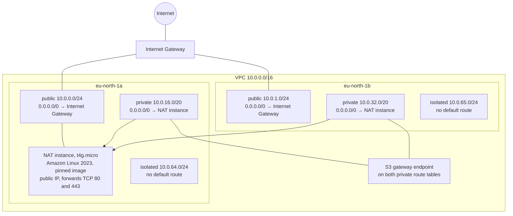
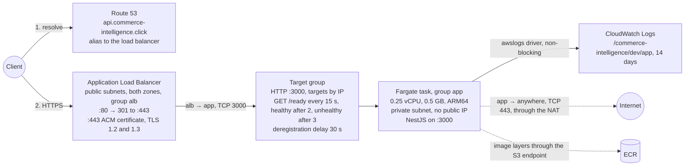
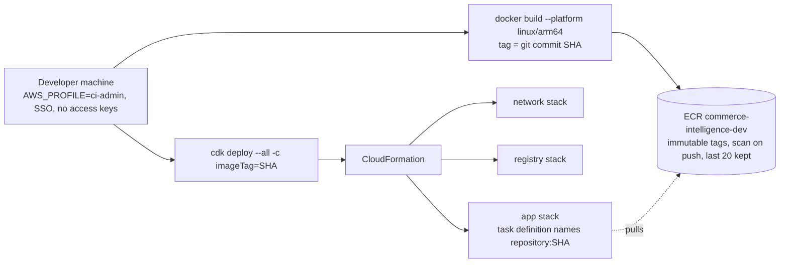

# Architecture

The Commerce Intelligence environment as deployed: stage `dev`, region `eu-north-1`, three
CloudFormation stacks defined with AWS CDK in `infra/`. This file describes what runs; the design
doc of each task records why it is shaped that way. It is updated as the environment grows.

**Last updated:** 2026-10-22, Task 1.4. Task 1.5 adds the pipeline; Task 2.1 adds the database.

## 1. The network

Stack `commerce-intelligence-dev-network`. One VPC over two availability zones, three tiers of
subnets, one NAT instance, a free S3 gateway endpoint. Address space for a third zone is reserved
(`10.0.2.0/24`, `10.0.48.0/20`, `10.0.66.0/24`) so adding it later renumbers nothing.

Every subnet has its own route table. Public subnets do not assign public IPs on launch; the load
balancer and the NAT instance ask for theirs. Rejected traffic is logged to
`/commerce-intelligence/dev/vpc-flow-logs` for 14 days.

Security groups are the whole list of allowed traffic between tiers. None allows all outbound.

| Group  | Inbound                              | Outbound                                            |
| ------ | ------------------------------------ | --------------------------------------------------- |
| `alb`  | TCP 80 and 443 from anywhere         | TCP 3000 to `app`                                   |
| `app`  | TCP 3000 from `alb`                  | TCP 443 to anywhere; TCP 3306 to `data`             |
| `data` | TCP 3306 from `app`                  | none                                                |
| NAT    | all traffic from `10.0.0.0/16`       | TCP 80 and 443 to anywhere                          |

## 2. The request path

Stack `commerce-intelligence-dev-app`. One public hostname, TLS ended at the load balancer, one
Fargate task in a private subnet, logs to CloudWatch.

The service keeps one task, rolls out at 100 % minimum and 200 % maximum, and rolls back by itself
when a new task definition never passes the health check. The app keeps idle connections for 65 s
because the load balancer keeps them for 60 s.

## 3. The delivery path

Done by hand until Task 1.5. The image is built from a clean commit and tagged with its SHA; the
deploy names the tag; a rollback is the same deploy with an older tag.

Task 1.5 replaces the developer machine with two GitHub Actions workflows and two IAM roles
assumed through OIDC: a read-only role for pull requests (gate, Docker build, `cdk diff` posted on
the pull request) and a deploy role for `main` (build, push, deploy, wait for health, report).

## 4. The stacks

| Stack                                | Holds                                                                                                                   | Depended on by           | Termination protection                    |
| ------------------------------------ | ----------------------------------------------------------------------------------------------------------------------- | ------------------------ | ----------------------------------------- |
| `commerce-intelligence-dev-network`  | VPC, subnets, route tables, Internet Gateway, NAT instance, S3 endpoint, the four security groups, the reject flow log   | the app stack, weakly    | on                                        |
| `commerce-intelligence-dev-registry` | the ECR repository, retained on delete                                                                                  | the app stack, weakly    | on                                        |
| `commerce-intelligence-dev-app`      | cluster, log group, task definition and its two roles, service, load balancer, listeners, target group, certificate, DNS record | nothing                  | off: the stack removed on purpose for a pause |

The app stack reads the other two through weak references: CloudFormation does not enforce the
dependency, the diff review and termination protection do. The whole environment costs about
44 USD a month; the table is in the README.

## Where the reasons are

- `task-1.2-design.md`: the network, the tiers, the security groups.
- `task-1.3-design.md`: compute, the load balancer, the certificate, the NAT instance.
- `task-1.4-design.md`: state, termination protection, the pinned image, how changes are reviewed.
- `README.md`: the procedures: deploy, review and apply, tear-down.
