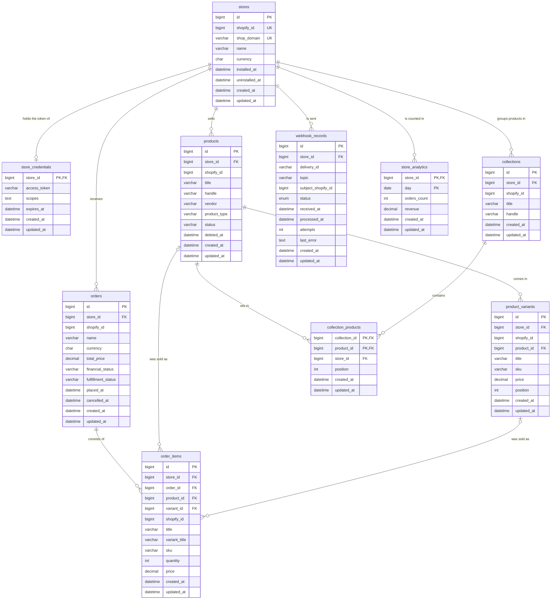

# Task 2.2 — Database modeling: Design

**Date:** 2026-10-29
**Branch:** `feat/task-2.2-database-modeling`
**Status:** design agreed in chat on 2026-10-29; not yet built.
**Spec:** `docs/Boris-ing.md`, section 4, Task 2.2 (lines 314–353); phase deliverables and
acceptance criteria at lines 406–421; phase questions at lines 390–404.

This document records what was decided for Task 2.2 and why. A builder should be able to implement
from it without going back to the author. Every decision in it was taken by Boris in chat and is
marked **(Boris)**; the alternatives he rejected are given with each. The ERD the spec asks for
before the schema is §5.1 of this document. The mechanical details left open on purpose are listed
in §8, and every file is shown in chat before it is written.

---

## 1. Intent

Task 2.1 gave the app a MySQL server and a connection; the database is empty. Task 2.2 designs what
goes in it: ten tables for the shops that install the app and their commerce data, drawn first as
an Entity Relationship Diagram and then written as Drizzle table definitions in TypeScript, one
file per table, each with a spec that checks its keys, pointers and rules.

Every row belongs to a store, and the database itself checks that a child row's store is its
parent's store. Rows are identified by our own numbers; Shopify's ids are kept beside them, unique
within a store. Deleting a store row erases everything the store owned in one statement. A product
Shopify deletes is kept and marked, so sold history stays whole. Money is exact, times are UTC, and
the ERD in this document is held to the code by a test.

Nothing is created in any database by this task. The tables arrive with the first migration of
Task 2.3; queries are Task 2.4. The companion `task-2.2-questions.md` gives the two explanations
the spec asks for, when to split an entity into two tables and how foreign keys, referential
integrity, cascading and indexing work, answers the six phase questions whose material this task
builds, and gives the reasons behind every decision here.

## 2. Goals, non-goals, anti-goals

**Goals**

- Every item of spec lines 316–353 traced to a decision (§4.1).
- An ERD of the ten entities in this document, drawn before any table file exists (§4.2, §5.1).
- Ten table definitions in `src/database/schema/`, one file each: our own keys, Shopify's ids
  unique within a store, `store_id` on every table and checked by the database (§4.3, §4.4).
- The three relationship kinds the spec names, built: the shared-key one-to-one, the pair-pointer
  one-to-many, the pair-key many-to-many (§4.5, §4.6, §4.7).
- The webhook record and the analytics row defined for the phases that fill them (§4.8, §4.9).
- Column conventions fixed for every later task: money, time, names, ids (§4.10).
- A spec per table and a spec that holds the ERD to the code, all in `npm test` (§4.11).
- The questions doc; the README status line (§4.12).

**Non-goals** (later)

- Creating the tables anywhere, the migration tool, the first migration: Task 2.3.
- Indexes for queries beyond the keys and the pointers, and the query analysis: Task 2.3 ("create
  indexes using migrations") and Task 2.4 ("indexes for common queries").
- Reading or writing rows, transactions, pagination, filtering: Task 2.4.
- Wiring the schema object into the `DATABASE` provider for typed queries: Task 2.4, with the first
  query.
- Columns the Shopify integration (Phase 3), the events (Phase 4) and the import (Phase 5) find they
  need, such as shop metadata, inventory, customers, refunds: by migration, when the need is concrete.
- Encrypting the access token: Task 3.3.
- Filling the webhook and analytics tables: Phases 4 and 5. Synchronization status: Phase 5.

**Anti-goals**

- A primary key chosen by Shopify, or a random code as a primary key.
- A table without `store_id`, or a child whose store can differ from its parent's unseen.
- A secret column on the stores row.
- A delete that silently removes sold history; a store erase that has to remember nine tables.
- A duplicate product-collection pair; a duplicate Shopify object within a store.
- Money in floating point; a time whose value depends on the connection's time zone.
- An ERD that says something the code does not.
- Anything from Task 2.3 in this task.

## 3. Constraints

| Constraint | Value |
|---|---|
| Task boundary | Spec lines 314–353 only. No migration, no drizzle-kit, no table created in any database: those are Task 2.3 (Boris, 2026-10-29) |
| Database, from 2.1 | MySQL 8.4 on RDS, InnoDB, utf8mb4 by default, TLS required, 20 GiB; the same image locally and in the e2e suite |
| Drizzle | `drizzle-orm` 0.45.4 on `mysql2`; the `DATABASE` provider is Drizzle on the pool without a schema object (2.1 §4.7). `bigint` takes `unsigned`; `decimal` takes `precision` and `scale`; `datetime` takes `fsp`, and only `timestamp` has `onUpdateNow()`, so the app stamps `updated_at` through `$onUpdate`; `foreignKey` takes several columns; `getTableConfig` exposes columns, indexes, primary keys, unique constraints and foreign keys |
| MySQL, multi-column pointers | The referenced columns must be the leading columns of an index on the parent, so a parent referenced by its pair `(store_id, id)` carries a unique index on that pair. `ON DELETE SET NULL` empties every column of the pointer, `store_id` included, so a pointer that may be emptied is single-column |
| MySQL, names | A table, index or constraint name is at most 64 characters |
| Shopify | Ids are 64-bit integers; money arrives as decimal text such as `"19.99"`; times as ISO 8601 with an offset; every webhook delivery carries its own id in `X-Shopify-Webhook-Id` and the shop's `myshopify.com` domain in `X-Shopify-Shop-Domain` |
| Tests | `npm test` is vitest; unit specs sit next to the source and boot nothing from Nest; spec files hold `it` blocks only. The e2e suite is untouched by this task |
| Budget | 75 USD; nothing in this task costs anything |
| Decided earlier, not reopened | Drizzle on a plain pool (2.1 §4.7); no schema created by hand or at boot (2.1 anti-goals); one responsibility per file; relative imports end in `.js` |
| Process | TDD, every file shown before it is written, decisions one at a time |

## 4. Decisions

### 4.1 The spec traced

| Spec | Where |
|---|---|
| Design the ten entities (lines 318–327) | §5, one table each; "products within collections" is the pair table `collection_products` |
| Create an ERD before implementing the schema (329) | §5.1, in this document, written in build step 1 before any table file |
| One-to-one: Store ↔ Store Credentials (333–335) | §4.5, the shared key |
| Explain when splitting entities into separate tables is appropriate (337) | questions doc §1 |
| One-to-many: Store → Orders, Order → Order Items, Product → Variants (339–345) | §4.4 and §4.6; the pointers in §5.2 |
| Explain foreign keys, referential integrity, cascading operations, indexing (347) | questions doc §2 |
| Many-to-many: Products ↔ Collections, a junction table with unique constraints (349–353) | §4.7 |
| Deliverables: Database ERD (410), database entities (412), database tests (413) | §5.1, §5.2, §4.11 |
| Phase questions 1, 2, 3, 4, 11, 12 (392–395, 402–403) | questions doc §3 |

The acceptance line (419) is met by Tasks 2.3 and 2.4; this task's part is a schema they can apply.

### 4.2 The ERD

**(Boris, decision 1)** The ERD is drawn in Mermaid inside this document, §5.1, next to the decisions
that shaped it. GitHub renders it, a pull request reviews it line by line, and the same text format
already draws the environment in `architecture.md`. A spec holds it to the code (§4.11).

Rejected: **its own file** `task-2.2-erd.md`: the same drawing in a second file to keep in step with
this one, while the reviewer reads drawing and reasons together here. **An image from a diagram
tool**: not reviewable line by line, and stale the first time a column changes.

### 4.3 Keys: what identifies a row, and how Shopify's ids are kept

**(Boris, decision 2)** Every table's primary key is our own number: `id BIGINT UNSIGNED`, handed
out by MySQL on insert, except the three tables whose key is a pair (§4.5, §4.7, §4.9). Shopify's
id is kept in a separate column, `shopify_id BIGINT UNSIGNED`, as the number alone, with a unique
rule on `(store_id, shopify_id)`.

Rejected: **Shopify's id as the primary key**: an outside system would own our identity, half the
tables have no Shopify id, and nothing could be stored in a test or on a laptop that Shopify had not
numbered first. **A UUID**: MySQL stores rows in primary-key order, so random keys land new rows
all over the table and slow inserts and indexes as tables grow; sixteen bytes copied into every
index and pointer against eight. **The GraphQL id text** `gid://shopify/Product/123`: thirty bytes
repeating what the table name says, slower to compare, rebuilt in one line when the API needs it.

### 4.4 Tenant isolation: how every row is tied to its store

**(Boris, decision 3)** Every table carries `store_id`, grandchildren included: order items,
variants and collection pairs carry it next to their parent's id. Every query says `store_id = ?`
directly, and every unique rule and pointer index starts with `store_id`.

**(Boris, decision 3b)** The database checks that a child's store is its parent's store: a
grandchild's pointer is the pair `(store_id, parent_id)` referencing the parent's `(store_id, id)`,
so a row with the wrong store is refused on write, forever, not only where a test looked. Each
parent referenced that way carries a unique index on `(store_id, id)`, which MySQL requires of a
pair target.

Rejected: **`store_id` on direct children only**: "all items this store sold" needs a detour through
orders, and a query that forgets the detour returns another store's rows. **A schema per store**:
every migration once per store, a connection set per store, on one small server. **The app sets
the child's store from the parent**: an app bug writing the wrong store is exactly the leak the
column exists to prevent, and a test catches only the cases someone thought of.

What follows: direct children (products, collections, orders, webhook records, analytics) point at
`stores.id` with a single-column pointer; their unique rule `(store_id, shopify_id)` or key
`(store_id, day)` already starts with `store_id`, which MySQL requires of a pointer column. The
one place the pair check does not apply is an order item's pointers to its product and variant,
which may be emptied (§4.6): MySQL's `SET NULL` would empty `store_id` with them, so those two are
single-column pointers to `id`, and the store match there is the app's to keep.

### 4.5 Store and credentials: the one-to-one

**(Boris, decision 4)** `store_credentials.store_id` is both the primary key and the pointer to
`stores.id`, so one row per store is a property of the key itself, with no second number.

Rejected: **own id plus a unique `store_id`**: a number nothing points at, and the one-row rule
needs an extra index instead of coming free. **The token on the stores row**: the spec lists
credentials as an entity (319) and wants the one-to-one shown (335); apart, the token is read only
by the code that calls Shopify, Task 3.3 encrypts that one table, and the stores row that analytics
and listings read all day carries no secret. That reasoning answers line 337 in the questions doc.

### 4.6 Deletes: cascades, the soft delete, the emptied pointer

**(Boris, decision 5a)** Deleting a store row cascades to every row carrying its `store_id`, across
all nine tables, in one statement. Uninstall itself does not delete the row: the app sets
`uninstalled_at` and deletes the credentials row, since the token is dead. Deleting the store row
is the erase step.

Rejected: **refuse while children exist**: nine deletes in the right order inside one transaction,
by hand, and a table added later that nobody adds to the list makes every erase fail. **Never
delete**: a shop that left keeps its orders and its customers' purchases in our database for good,
and Shopify asks apps to erase a shop's data after it uninstalls.

**(Boris, decision 5b)** A product Shopify deletes is kept: `products.deleted_at` is set, listings
hide it, its variants stay. Order history and "most frequently purchased products" (line 126)
still reach it by id.

Rejected: **hard delete with a copy on the order item**: analytics counted from copied text
instead of product rows, and a product renamed between two sales counts as two products. **Hard
delete, cascade**: sold history disappears with the product, and last month's revenue changes
after the fact.

What follows: a variant cannot exist without its product, and a pair without its product or its
collection, so those pointers cascade. An order item keeps `title`, `variant_title`, `sku`,
`quantity` and `price` as sold, because they are facts of the order and prices change. Its
pointers to product and variant are emptied, not refused, if the row they point at ever goes
(the store cascade of 5a reaches variants through products and items through orders in no fixed
order, and a refusal on either path would block the erase). Deleting a collection removes its
pairs and nothing else.

### 4.7 Products and collections: the junction table

**(Boris, decision 6)** `collection_products` has the pair `(collection_id, product_id)` as its
primary key and no number of its own, so a second row for the same pair is impossible by
construction. This is the unique constraint line 353 asks for.

Rejected: **own id plus a unique rule on the pair**: a number nothing points at, and two structures
where one does the job. **A list of collection ids in a column on the product**: not checkable by
the database, not indexable for "products in this collection", and exactly the shape normalization
removes.

What follows: `store_id` and the two pair pointers of §4.4; the index `(store_id, product_id)`
for "collections of this product", which also backs that pointer; the index
`(store_id, collection_id)` backing the other; `position`, since Shopify reports a product's order
inside a collection.

### 4.8 Webhook processing records

**(Boris, decision 7a)** One row per delivery Shopify sends: the store, the `topic`
(`orders/create`), Shopify's `delivery_id`, the Shopify id of the order or product the event
concerns, the `status` (`received`, `processed`, `failed`), `received_at`, `processed_at`,
`attempts`, `last_error`. The row does not hold the message body; the queue Phase 4 introduces
carries that.

**(Boris, decision 7b)** Unique on the pair `(store_id, delivery_id)`.

Rejected: **one row per try**: rows multiply with retries, and "was this already handled" becomes a
search instead of a key lookup. **Counters only**: a redelivery cannot be told from a new event, so
an order could count twice, and a failure leaves nothing to retry from. **Unique on the delivery id
alone**: works today, but would be the one rule not tied to a store, and the statistics lookups by
store would need a second index anyway.

### 4.9 Store analytics

**(Boris, decision 8)** One row per store per day: `(store_id, day)` is the key, with that day's
`orders_count` and `revenue` in the store's currency, which `stores.currency` records. A total is
the sum of a store's rows; "over time" is a range of them. Most purchased products are counted from
order items; webhook statistics from §4.8's table. The rows are filled by the event processing and
the import of later phases.

Rejected: **one row per store with lifetime totals**: "revenue over time" and "order counts over
time" (lines 125, 128) cannot come from one row, so the table would serve two of seven endpoints.
**No stored numbers**: every request walks every order the store ever had; a store with a million
orders makes the API slower each day. This table is the phase's denormalization example (line 395).

### 4.10 Column conventions

**(Boris, decision 9a)** Money is `DECIMAL(19,4)`: exact, four places after the point. Rejected:
whole numbers of the smallest unit, because currencies differ in their number of places and every
read and write would convert by a currency-dependent factor; floating point, because it cannot
hold `0.10` and totals must add up to the cent.

**(Boris, decision 9b)** Times are `DATETIME(3)` in UTC, written by the app; `created_at` defaults
to now and `updated_at` is set by the app on every update, since Drizzle's `datetime` column cannot
declare MySQL's on-update rule (decided 2026-10-29, after the first red run). Rejected:
`TIMESTAMP`, whose value depends on the connection's time zone setting and ends in January 2038;
`TIMESTAMP(3)` for the two stamp columns only, two time types for one purpose; the on-update rule
written by hand into a 2.3 migration, invisible in the definitions and lost on the next generation.

**(Boris, decision 9c)** Table names plural snake_case, columns snake_case, camelCase properties in
TypeScript mapped to them. Rejected: singular names, since `order` is a reserved word in SQL and a
table is a set of rows.

What follows: our ids and Shopify's are `BIGINT UNSIGNED`. Every table carries `created_at` and
`updated_at`. Text is utf8mb4, the server's default. A state Shopify defines (`status`,
`financial_status`, `fulfillment_status`) is `VARCHAR(32)`, so a value Shopify adds needs no
migration; a state we define (`webhook_records.status`) is an `ENUM`. Index and constraint names
are `<table>_<columns>_<kind>`, under 64 characters.

### 4.11 Tests

**(Boris, decision 10a)** One spec per table, next to its definition, checking through
`getTableConfig` what the spec of 2.2 names: the table name, the primary key, each pointer with
its target and its delete rule, each unique rule, each index. They run in `npm test` with no
database. Rejected: one spec for the whole schema, which grows past a glance and fails as "the
schema"; no tests until 2.3, against the TDD rule and leaving a wrong delete rule for a task.

**(Boris, decision 10b)** A spec reads the ERD out of §5.1 and checks it against the code both
ways: every entity is a table and every table an entity, every attribute a column and every column
an attribute, every relationship line a pointer and every pointer a line, with the key marks
matching. Whoever changes a table in a later task updates the drawing, or the gate fails. Rejected:
checking by eye, which drifts the first time someone adds a column.

What 2.2 cannot test: that MySQL accepts the definitions. That is proven in 2.3 when the first
migration runs in the test container. The e2e suite is unchanged.

### 4.12 Documentation

**(Boris, decision 11a)** The questions doc answers the spec's two explanations (lines 337 and 347)
and the six phase questions whose material this task builds: 1 primary and foreign keys, 2
composite indexes, 3 normalization, 4 denormalization, 11 how Shopify ids are represented, 12 how
tenant isolation is enforced; then "Why we picked what we picked". The other seven phase questions
wait for 2.3 and 2.4. The seven general questions (lines 71–77) are for a technology decision, and
this task makes none; the seven for Drizzle itself are answered in 2.3, where it first runs
against the database. Rejected: all thirteen now, as theory not tied to what was built; none now,
recalling 2.2's reasoning in 2.4 instead of recording it.

**(Boris, decision 11b)** `architecture.md` is unchanged: nothing that runs changes, and the
deployed database has no tables until 2.3 applies the schema, which then adds them to the picture.

**(Boris, decision 11c)** The README status line says Task 2.2 built when it is, and its docs list
gains the two 2.2 docs; nothing else in it changes. `CLAUDE.md` gains "Conventions from Task 2.2".

## 5. The schema

### 5.1 The ERD

### 5.2 The tables, column by column

Common to every table unless said otherwise: `id BIGINT UNSIGNED AUTO_INCREMENT` as the primary
key; `store_id BIGINT UNSIGNED NOT NULL`; `shopify_id BIGINT UNSIGNED NOT NULL` with the unique
rule `(store_id, shopify_id)`; `created_at DATETIME(3) NOT NULL DEFAULT CURRENT_TIMESTAMP(3)` and
`updated_at DATETIME(3) NOT NULL DEFAULT CURRENT_TIMESTAMP(3)`, set by the app on every update.
Every column is `NOT NULL` unless marked null.

**`stores`** — one row per shop that installed the app.

| Column | Type | Notes |
|---|---|---|
| `shopify_id` | `BIGINT UNSIGNED` | the shop's id at Shopify; unique on its own, there is no store above a store |
| `shop_domain` | `VARCHAR(255)` | `name.myshopify.com`, what webhooks and the auth flow carry; unique |
| `name` | `VARCHAR(255)` | |
| `currency` | `CHAR(3)` | the shop's currency, ISO 4217; revenue is in it |
| `installed_at` | `DATETIME(3)` | set again on a reinstall |
| `uninstalled_at` | `DATETIME(3)`, null | set on uninstall, cleared on reinstall; the row stays until erased (§4.6) |

Pointers: none. Keys: `id`; unique `shopify_id`; unique `shop_domain`.

**`store_credentials`** — the token, one row per installed store.

| Column | Type | Notes |
|---|---|---|
| `store_id` | `BIGINT UNSIGNED` | primary key and pointer to `stores.id`, cascade |
| `access_token` | `VARCHAR(255)` | as Shopify gives it; Task 3.3 changes this column to the encrypted form by migration |
| `scopes` | `TEXT` | the granted scopes as Shopify lists them |
| `expires_at` | `DATETIME(3)`, null | empty for a token that does not expire |

No `id`, no `shopify_id`. Keys: `store_id`.

**`products`**

| Column | Type | Notes |
|---|---|---|
| `title` | `VARCHAR(255)` | |
| `handle` | `VARCHAR(255)` | Shopify's URL name |
| `vendor` | `VARCHAR(255)`, null | |
| `product_type` | `VARCHAR(255)`, null | |
| `status` | `VARCHAR(32)` | Shopify's `active`, `archived`, `draft` |
| `deleted_at` | `DATETIME(3)`, null | the soft delete (§4.6) |

Pointers: `store_id` → `stores.id`, cascade. Keys: `id`; unique `(store_id, shopify_id)`; unique
`(store_id, id)`, the pair target.

**`product_variants`**

| Column | Type | Notes |
|---|---|---|
| `product_id` | `BIGINT UNSIGNED` | |
| `title` | `VARCHAR(255)` | |
| `sku` | `VARCHAR(255)`, null | |
| `price` | `DECIMAL(19,4)` | |
| `position` | `INT UNSIGNED` | Shopify's order of the variant inside its product |

Pointers: `(store_id, product_id)` → `products (store_id, id)`, cascade. Keys: `id`; unique
`(store_id, shopify_id)`; unique `(store_id, id)`, the pair target; index `(store_id, product_id)`,
backing the pointer.

**`collections`**

| Column | Type | Notes |
|---|---|---|
| `title` | `VARCHAR(255)` | |
| `handle` | `VARCHAR(255)` | |

Pointers: `store_id` → `stores.id`, cascade. Keys: `id`; unique `(store_id, shopify_id)`; unique
`(store_id, id)`, the pair target.

**`collection_products`** — the spec's "products within collections".

| Column | Type | Notes |
|---|---|---|
| `collection_id` | `BIGINT UNSIGNED` | |
| `product_id` | `BIGINT UNSIGNED` | |
| `position` | `INT UNSIGNED` | Shopify's order of the product inside the collection |

No `id`, no `shopify_id`. Pointers: `(store_id, collection_id)` → `collections (store_id, id)`,
cascade; `(store_id, product_id)` → `products (store_id, id)`, cascade. Keys: primary
`(collection_id, product_id)`; index `(store_id, collection_id)` and index `(store_id, product_id)`,
backing the pointers, the second also serving "collections of this product".

**`orders`**

| Column | Type | Notes |
|---|---|---|
| `name` | `VARCHAR(255)` | Shopify's order name, `#1001` |
| `currency` | `CHAR(3)` | |
| `total_price` | `DECIMAL(19,4)` | the revenue of the order |
| `financial_status` | `VARCHAR(32)` | Shopify's `paid`, `refunded`, … |
| `fulfillment_status` | `VARCHAR(32)`, null | |
| `placed_at` | `DATETIME(3)` | Shopify's creation time of the order, in UTC |
| `cancelled_at` | `DATETIME(3)`, null | |

Pointers: `store_id` → `stores.id`, cascade. Keys: `id`; unique `(store_id, shopify_id)`; unique
`(store_id, id)`, the pair target.

**`order_items`**

| Column | Type | Notes |
|---|---|---|
| `order_id` | `BIGINT UNSIGNED` | |
| `product_id` | `BIGINT UNSIGNED`, null | emptied if the product row ever goes (§4.6) |
| `variant_id` | `BIGINT UNSIGNED`, null | emptied if the variant row ever goes |
| `shopify_id` | `BIGINT UNSIGNED` | Shopify's line item id |
| `title` | `VARCHAR(255)` | as sold |
| `variant_title` | `VARCHAR(255)`, null | as sold |
| `sku` | `VARCHAR(255)`, null | as sold |
| `quantity` | `INT UNSIGNED` | |
| `price` | `DECIMAL(19,4)` | unit price as sold |

Pointers: `(store_id, order_id)` → `orders (store_id, id)`, cascade; `product_id` →
`products.id`, set null; `variant_id` → `product_variants.id`, set null. Keys: `id`; unique
`(store_id, shopify_id)`; index `(store_id, order_id)`, index `product_id`, index `variant_id`,
backing the pointers.

**`webhook_records`** — the spec's "webhook processing records"; one row per delivery.

| Column | Type | Notes |
|---|---|---|
| `delivery_id` | `VARCHAR(64)` | Shopify's `X-Shopify-Webhook-Id` |
| `topic` | `VARCHAR(64)` | `orders/create`, `products/delete`, … |
| `subject_shopify_id` | `BIGINT UNSIGNED`, null | the order or product the event concerns; empty for `app/uninstalled` |
| `status` | `ENUM('received','processed','failed')` | ours |
| `received_at` | `DATETIME(3)` | |
| `processed_at` | `DATETIME(3)`, null | |
| `attempts` | `INT UNSIGNED`, default 0 | |
| `last_error` | `TEXT`, null | |

No `shopify_id`. Pointers: `store_id` → `stores.id`, cascade. Keys: `id`; unique
`(store_id, delivery_id)`.

**`store_analytics`** — one row per store per day.

| Column | Type | Notes |
|---|---|---|
| `day` | `DATE` | the UTC day |
| `orders_count` | `INT UNSIGNED`, default 0 | |
| `revenue` | `DECIMAL(19,4)`, default 0 | in `stores.currency` |

No `id`, no `shopify_id`. Pointers: `store_id` → `stores.id`, cascade. Keys: primary
`(store_id, day)`.

### 5.3 The code

`src/database/schema/`, one file per table named for it (`stores.ts`, `store-credentials.ts`, …),
each exporting one `mysqlTable`; the shared column pieces (`id`, `storeId`, `shopifyId`,
`createdAt`, `updatedAt`) in files named for the concept; `index.ts` re-exporting every table, the
one import later tasks use. A spec next to each table file; the ERD spec in the same folder reads
§5.1 of this document.

## 6. Build order

One piece at a time. Each piece: show the failing spec in chat → approval → write it → run it red →
show the implementation in chat → approval → write it → run it green → run the whole gate.

1. Branch `feat/task-2.2-database-modeling`; this document, the ERD in it, before any table file.
2. The shared column pieces, covered by the first table's spec.
3. `stores`.
4. `store_credentials`: the shared key.
5. `products`, then `product_variants`: the soft delete, the pair pointer.
6. `collections`, then `collection_products`: the pair key.
7. `orders`, then `order_items`: the pair pointer, the emptied pointers.
8. `webhook_records`.
9. `store_analytics`.
10. `index.ts`; the ERD spec, broken once on purpose to see it red.
11. Docs: the questions doc; the README status line and docs list; `CLAUDE.md` "Conventions from
    Task 2.2".
12. Gate; push; the pull request; the four checks green; merge. The deploy run green with `/ready`
    still up, since nothing of the database changes; `cdk diff` clean.

Commits happen when Boris says so.

## 7. Done when

- `npm test`, `npm run test:e2e` (with Docker running), `npm run typecheck`, `npm run lint`,
  `npm run format:check` and `npm run infra:check` pass; `npm test` runs ten table specs and the
  ERD spec.
- `src/database/schema/` holds the ten tables and `index.ts`; every table carries the keys, unique
  rules, pointers, delete rules and indexes of §5.2, exactly.
- §5.1 matches the code both ways, enforced by the ERD spec.
- The questions doc exists with the sections of §4.12; the README status line says Task 2.2 built.
- The pull request is merged, the deploy run is green, `/ready` answers 200 with the database up,
  and `cdk diff` reports nothing.

## 8. Left to the builder

- The exact `it` names; the names of the shared-column files; whether `id` is a shared piece or
  written per table.
- Index and constraint names, in the `<table>_<columns>_<kind>` form, under 64 characters.
- The ERD spec's parsing of §5.1: entity blocks, attribute lines, relationship lines, and the
  mapping of a relationship line to a pointer.
- Drizzle's `mode` for the 64-bit columns: `number`, safe to 2^53 (Shopify's ids today are around
  10^13), or `bigint`; the questions doc's answer to phase question 11 states the choice.
- `VARCHAR` lengths where Shopify allows more than 255 characters.
